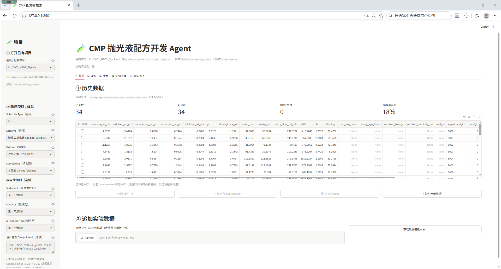
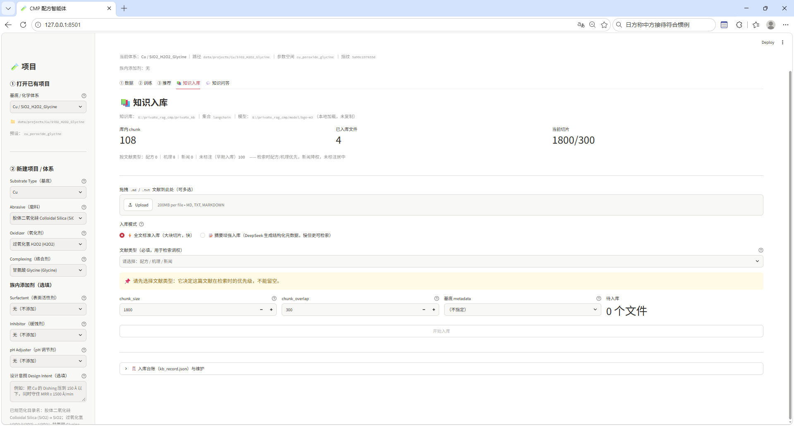
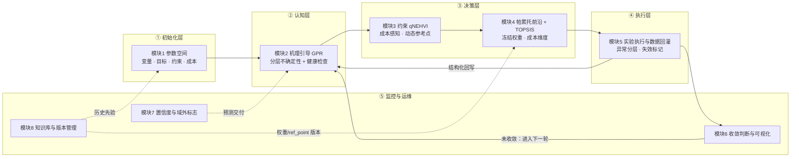
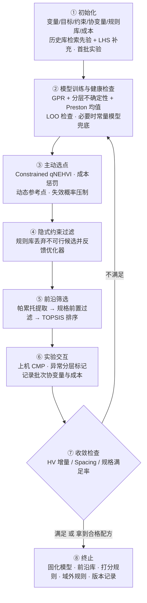

# CMP 抛光液配方开发 Agent

> **CMP-Agent-Project**: Human-in-the-loop closed-loop experimental agent for copper CMP slurry formulation.
>
> **Stack**: `botorch`+`GPyTorch` (qNEHVI), GPR with Preston prior, Pareto-TOPSIS post-processing, experiment ledger with anomaly triage, `streamlit` UI, chemical-specific RAG microservice, compatible with DeepSeek-Harness as agent workspace.
>
> ⚠️ **Note**: Domain-specific prototype, **NOT** a general-purpose SDK. Built specifically for CMP slurry optimization, not intended for out-of-the-box use in other chemistry domains.

> **一个闭环实验智能体（closed-loop experimental agent），不是静态预测模型。**
> 主动采样贝叶斯优化探路 → 帕累托前沿提取 → TOPSIS 辅助决策 → 下发实验 → 实测数据回灌 → 模型增量更新 → 再采样。
> 最终交付两项能力：**配方性能预测**（含分层不确定性与域外标志）与**候选配方主动推荐**（硬约束已满足、隐式约束已过滤、高失效概率已压低）。

| 项目状态 | 说明 |
| --- | --- |
| 当前阶段 | 模块 1–5（算法闭环）+ Streamlit Web 界面 + 本地 RAG 知识库（微服务）已实现并通过真实自检；模块 6–8 暂缓 |
| 运行环境 | 已验证：torch 2.15.0+cpu / botorch 0.18.1 / gpytorch 1.15.2 / streamlit 1.67 / Python 3.15 |
| 代码规模 | `config.py`(1) + `surrogate_model.py`(2) + `acquisition.py`(3) + `pareto.py`(4) + `experiment.py`(5) + `app.py`(UI) + `rag_service.py`/`rag_bridge.py`(RAG) |
| 集成测试 | `python tests/test_all.py` → **14 个用例全绿，exit=0**（约 30 s） |
| Web 界面 | `streamlit run src/app.py` → http://127.0.0.1:8501 |
| 配置指纹 | `5a99c197655d`（`python -m src.config` 可复现） |
| 默认问题 | 铜 CMP：胶体二氧化硅 + H₂O₂ + 甘氨酸，10 维连续空间，3 目标，9 条硬约束 |

---

## 目录

1. [为什么必须是"闭环 Agent"](#1-为什么必须是闭环-agent)
2. [核心原则：TOPSIS 只做后处理](#2-核心原则topsis-只做后处理)
3. [系统架构：八大模块](#3-系统架构八大模块)
4. [完整串行闭环链路（8 步）](#4-完整串行闭环链路8-步)
5. [已交付模块详解（模块 1–5 + Web 界面）](#5-已交付模块详解模块-15)
6. [跨模块数据契约](#6-跨模块数据契约)
7. [快速开始](#7-快速开始)
8. [目录结构](#8-目录结构)
9. [学术论证与消融实验设计](#9-学术论证与消融实验设计)
10. [版本管理与审计](#10-版本管理与审计)
11. [路线图与展望](#11-路线图与展望)
12. [已知局限](#12-已知局限)
13. [Related Works（相关工作）](#related-works-相关工作)
14. [AI-Assisted Development Disclaimer（AI 辅助开发声明）](#ai-assisted-development-disclaimer-ai-辅助开发声明)
15. [参考文献与依据](#参考文献与依据)

---

## 1. 为什么必须是"闭环 Agent"

CMP 抛光液开发有三个让"训练一个模型"注定失败的物理事实：

1. **数据极度稀缺且昂贵。** 一轮配方实验 = 配液 + 一片 300 mm 图形片（约 4200 元、可复用 6 次）+ 约 1 小时 CMP 机台 + 三套计量，单次成本 2000 元量级。100 条样本意味着 20 万元和数周机时。静态模型没有足够数据可学。
2. **目标天然冲突。** 提高磨料固含或压力能拉高 MRR，但会同时恶化 Ra 与 Dishing；增加缓蚀剂能压低 Dishing，却会拖慢去除速率。不存在"最优配方"，只存在**帕累托前沿**。
3. **存在大量非解析约束。** 浆料长期稳定性、颗粒团聚、发泡、划伤——没有可靠的闭式表达式，却有明确的工艺红线。

因此系统的核心不是"拟合"，而是**用最少的实验次数，把探索预算押在信息量最大的配方上**。这就是贝叶斯优化（BO）的职责；而三目标的权衡关系必须原样保留给工程师做决策——这是 TOPSIS 的职责。两者分工不可混淆。

---

## 2. 核心原则：TOPSIS 只做后处理

> **TOPSIS 只做前沿后处理筛选，不参与 BO 优化目标，避免权重主观偏差污染探索空间。**

这是全项目的最高约束，落地为三条硬性设计：

| 反模式 | 后果 | 本项目的做法 |
| --- | --- | --- |
| 把 MRR/Ra/Dishing 加权成一个标量目标送进 BO | 权重一旦偏斜，某些可行权衡点被**永久排除在搜索空间之外**，且无法事后补救 | BO 只优化**向量目标**（qNEHVI），保留完整帕累托关系 |
| 每轮根据结果重新调 TOPSIS 权重 | 推荐清单随轮次漂移，工程师无法判断"是配方变好了还是标准变松了" | 权重在初始化阶段**冻结**（`TopsisConfig.weights`），熵权仅作敏感性对照 |
| 用 TOPSIS 分数反过来筛选采集函数候选项 | 主观偏好反向污染探索路径，形成自我强化的偏见 | TOPSIS 只在**已经提取出的帕累托前沿**上排序，输入集合不受其影响 |

代价是超体积计算成本更高、推荐清单不是单一"最优解"——这是有意为之的取舍：**决策权留给工程师，Agent 只负责把权衡面探清楚**。

---

## 3. 系统架构：八大模块



| # | 模块 | 职责 | 关键实现点 | 状态 |
| :-: | --- | --- | --- | --- |
| 1 | 问题定义与参数空间 | 把研发需求翻译成优化空间、目标、约束、成本 | 变量上下限与类型、目标符号翻转、约束分类、LHS、物理规则表、成本模型 | ✅ 已实现 |
| 2 | 代理模型 | 学习配方→性能映射，输出均值 + 分层不确定性 | 各向异性 Matern-5/2、对数正态超参先验、Preston 均值函数、认知/偶然不确定性分层、批次协变量入模、三轮健康检查（ok/degraded/fallback）+ 常量后备 | ✅ 已实现 |
| 3 | 多目标采集函数 | 决定"下一个该做哪个配方" | 约束 qLogNEHVI、目标归一化、成本惩罚（λ）、动态参考点、后备目标剔除、可行初始点生成器、验证-修复、隐式规则前置过滤 | ✅ 已实现 |
| 4 | 前沿提取 + TOPSIS | 给工程师的辅助决策层 | `is_non_dominated`（与暴力法交叉验证）、规格前置过滤、向量归一化、冻结权重 + 成本维度、熵权敏感性对照、规格不可满足时降级 | ✅ 已实现 |
| 5 | 实验执行与数据回灌 | 与真实世界交互 | 台账 schema（v2）、结构化校验（11 类规则）、异常三分、批次协变量校验、JSON 往返、训练前门槛 | ✅ 已实现 |
| 6 | 收敛判断与可视化 | 监控与终止 | HV 边际增量、Spacing、Coverage、规格满足率、前沿散点与曲线、每轮日志 | ⬜ 待实现 |
| 7 | 置信度与域外标志 | 交付层 | 马氏距离/最近邻域外判定、常量模型后备联动、低置信度标记 | ⬜ 待实现 |
| 8 | 知识库与版本管理 | 工业运维 | 历史相似性检索提供初始先验、数据集/模型/ref_point/权重/规则库全版本化、人工干预开关 | ⬜ 待实现 |

### 模块 2–8 的设计要点（后续开发须遵守的约定）

- **模块 2（已实现）**：每个目标一个 `SingleTaskGP`（本实现用字典管理，等价于 `ModelListGP`），ARD 长度尺度即"机理感知的特征重要性"——实测在 40 条样本下，MRR 的最短长度尺度落在 `ph`、Ra 落在 `surfactant`、Dishing 落在 `inhibitor`，与合成真相里真正起作用的变量完全一致。MRR 的均值函数用 Preston 方程，让模型先学经典机理、再用残差学化学效应。健康检查分 ok / degraded / fallback 三级，只有"无预测力"才降级为**常量模型**。
- **模块 3（已实现）**：X 空间的解析约束**不能**塞进 `qNEHVI(constraints=...)`——那个接口吃的是后验采样值（`sample_shape × batch × q × m`），用来表达"结果超规格就降权"。设计变量的约束必须走
  `optimize_acqf(nonlinear_inequality_constraints=...)`，并且 callable 要可微（SLSQP 会求它的梯度）、约定是 `>= 0` 可行（与模块 1 的 `g <= 0` 相反）。给了非线性约束就必须自带 `ic_generator`。
- **模块 4（已实现）**：先按硬规格（Ra ≤ 4 Å、Dishing ≤ 150 Å）剔除前沿点，再在**剩余点**上做 TOPSIS。这一步不能省：模块 3 只负责把权衡面探开，实测推荐会落在高磨料/高氧化剂的角上（Dishing 200+ Å），因为 Dishing 在 BO 里是**目标**而不是**约束**——规格筛选是模块 4 的职责。实测：不做过滤时前 5 名里有 3 条不可交付。
- **模块 5（已实现）**：异常必须三分——**测量异常可剔除，响应异常必须保留并标记**（它可能正是真实物理），失效样本单独进失效集（不参与主目标）。**校验器不修改数据**，只报告 error/warning；另外，隐式规则库的 REJECT 级规则在台账里只记 warning——它应该约束"候选生成"，不该追溯性否定一次已经做完的真实实验。
- **模块 7**：域外标志与三个状态联动——后备状态的预测一律标"低置信度"；degraded 状态同样标低（能排序但不可交付）；sd_total/|mean| > 0.5 的单点也标低。

---

## 4. 完整串行闭环链路（8 步）



| 步 | 输入 | 输出 | 失败模式与处理 |
| :-: | --- | --- | --- |
| ① | 研发需求、产线规格、预算 | 初始数据集（16 条可行配方） | 历史先验只做初始化，**不能替代新基底校准实验** |
| ② | 数据集 + 协变量 | N 个 GPR 后验 | 某目标 MLL 优化异常 → 常量模型后备 + 低置信度标记 |
| ③ | 后验 + 约束 + 参考点 | q=3 个候选配方 | 候选全被过滤 → 放大探索权重重采样 |
| ④ | 候选 + 规则库 | 可上机清单 | 过滤率持续 > 50% → 提示优化器约束与规则库不一致 |
| ⑤ | 全部历史样本 | TOPSIS 排序清单 | 前沿为空 → 说明空间过紧，需回到模块 1 |
| ⑥ | 配方清单 | 结构化实验记录 | 异常三层标记，响应异常**保留** |
| ⑦ | HV/Spacing/满足率序列 | 继续 / 终止 | 连续 N 轮无改善 → 终止并固化 |
| ⑧ | 全部状态 | 可审计快照 | 哈希不一致 → 拒绝复现 |

---

## 5. 已交付模块详解（模块 1–4）

`src/config.py` 是模块 1 的唯一真源，导出 `CMPRecipeSpace` 及其全部子配置。核心调用面：

```python
from src.config import build_default_config

cfg = build_default_config()      # 或 build_config("oxide_ceria_anionic")

cfg.bounds()                      # (2, d) 物理量纲边界
cfg.unit_bounds_tensor()          # (2, d) torch 张量，单位立方
cfg.constraint_callables()        # [callable(X) -> (n,)], g <= 0 可行
cfg.implicit_rule_callables()     # [(name, callable(X) -> bool)]
cfg.reference_point()             # (m,) BoTorch 最大化符号空间
cfg.cost(X, mrr=...)              # 单次实验成本（元）
cfg.validate_recipe({...})        # 单条配方体检：越界/硬约束/隐式规则/成本
cfg.config_hash()                 # 配置指纹，写入实验记录
cfg.describe()                    # 人类可读摘要，可直接贴进实验记录
```

### 5.1 决策变量（10 维连续空间）

变量顺序即设计矩阵列顺序，所有约束按名取列（`_NamedView`），不写死下标。

| # | 变量 | 单位 | 范围 | 尺度 | 机理作用 |
| :-: | --- | :-: | --- | :-: | --- |
| 1 | `abrasive_wt_pct` | wt% | [0.5, 12] | linear | 磨料机械去除主体；过高→划伤/团聚，过低→MRR 不足 |
| 2 | `oxidizer_wt_pct` | wt% | [0.2, 8] | linear | H₂O₂ 氧化表面形成软质氧化层，决定化学去除速率 |
| 3 | `complexing_wt_pct` | wt% | [0.1, 4] | linear | 甘氨酸溶解金属离子、加速氧化层脱除；过量→过度腐蚀 |
| 4 | `surfactant_wt_pct` | wt% | [0, 0.50] | linear | 活性剂抑制凹处去除、降低 Dishing；过量→MRR 塌陷/起泡 |
| 5 | `inhibitor_wt_pct` | wt% | [0, 0.30] | linear | BTA 在铜面成膜，压制静态腐蚀与 Dishing |
| 6 | `ph` | – | [2, 11] | linear | 决定氧化剂稳定性、Zeta 电位与络合形态，最强化学杠杆之一 |
| 7 | `down_force_psi` | psi | [0.5, 5] | linear | Preston 方程中的 P：放大去除，也放大 Dishing |
| 8 | `platen_rpm` | rpm | [30, 150] | linear | 决定相对线速度 v，与压力构成机械作用项 P·v |
| 9 | `carrier_rpm` | rpm | [27, 135] | linear | 与盘转速之差决定面内去除均一性 |
| 10 | `slurry_flow_ml_min` | mL/min | [50, 300] | linear | 供液不足→干抛/划伤；过量→浪费并抬高成本 |

**类别变量（配方族上下文）**：`abrasive_type`、`oxidizer_type` 声明为 `contextual_variables`，**不进入连续采集函数**。不同化学体系（硅溶胶酸性 vs 氧化铈碱性）的性能曲面没有可迁移性，共用一个 ARD 核只会让长度尺度学成噪声。正确做法是**分层 BO（stratified BO）**：按族各跑一个子问题，外层调度器比较各族的最优前沿。预设见 `FAMILY_PRESETS`：

| 配方族 | 磨料 / 氧化剂 | pH 窗口 | Preston k |
| --- | --- | --- | --- |
| `cu_peroxide_glycine`（默认） | 胶体 SiO₂ / H₂O₂ | [2, 5.5] ∪ [8.5, 11] | 220 |
| `cu_alkaline_complex` | 胶体 SiO₂ / H₂O₂ | [8.5, 11] | 260 |
| `oxide_ceria_anionic` | 氧化铈 / H₂O₂ | [5.5, 8.5] | 520 |

### 5.2 优化目标

BoTorch 的多目标采集函数只认"越大越好"，因此最小化指标在进入模型前取负（`Objective.sign`）。**实测值永远按原量纲存储**，符号翻转只在接口处发生。

| 目标 | 方向 | 产线规格 | 先验可达范围 | BoTorch 符号 | TOPSIS 角色 | 权重 |
| --- | :-: | :-: | :-: | :-: | :-: | :-: |
| MRR | 最大化 | ≥ 1500 Å/min | 150 – 3200 Å/min | +1 | benefit | 0.40 |
| Ra | 最小化 | ≤ 4 Å | 1.2 – 10 Å | −1 | cost | 0.25 |
| Dishing | 最小化 | ≤ 150 Å | 30 – 450 Å | −1 | cost | 0.20 |
| Cost | 最小化 | – | 由 `CostModel` 现算（≈2100–2450 元） | – | cost | 0.15 |

`objective_matrix()` 返回 `((+1,), (-1,), (-1,))`，可直接用于 `GenericMCObjective(weights=...)`。

### 5.3 确定性硬约束（9 条，进 Constrained qNEHVI）

全部写成 `g(X) ≤ 0` 可行，与 `ConstrainedMCObjective` 的约定一致。默认空间下全盒 LHS 的硬约束通过率约 **32%**——这正是必须用约束 BO 而不是"随机撒点后过滤"的量化理由。

| # | 约束名 | 表达式 | 逻辑 | 化学 / 力学依据 |
| :-: | --- | --- | :-: | --- |
| 1 | `ph_stability_window` | pH ∈ [2, 5.5] ∪ [8.5, 11] | **ANY_OF** | H₂O₂ 在 pH 5.5–8.5 分解最快（金属离子催化），放气导致去除率漂移与缺陷 |
| 2 | `abrasive_oxidizer_ratio_low` | abrasive ≥ 0.3 · oxidizer | ALL_OF | 氧化剂相对磨料过量 → 化学去除主导，出现蚀坑与氧化层残留 |
| 3 | `abrasive_oxidizer_ratio_high` | abrasive ≤ 15 · oxidizer | ALL_OF | 磨料过量而氧化剂不足 → 进入纯机械区，划伤与 Dishing 恶化 |
| 4 | `total_solids` | Σ(磨料+络合+活性剂+缓蚀) ≤ 20 wt% | ALL_OF | 总固含超过 20 wt% 后黏度骤升，管路沉积、颗粒沉降不可控 |
| 5 | `surfactant_to_abrasive` | surfactant ≤ 0.25 · abrasive | ALL_OF | 活性剂包覆过量会屏蔽磨料机械作用 → MRR 塌陷 + 大量起泡 |
| 6 | `mechanical_dose` | P·π·D·(n_p+n_c)/120 ≤ 12 psi·m/s | ALL_OF | 超过抛光盘/垫允许比压与剪切 → 垫面快速磨损与划伤 |
| 7 | `chelator_to_oxidizer` | complexing ≤ 4 · oxidizer | ALL_OF | 络合剂远过量 → 直接溶解金属（化学腐蚀）而非去除氧化层 |
| 8 | `ionic_strength_proxy` | 0.28·complexing + 0.15·\|pH−7\| ≤ 1.2 | ALL_OF | 盐类压缩双电层致胶体失稳；H₂O₂ 为中性分子不贡献离子强度，盐负荷来自 pH 调节剂与络合阴离子。系数需按实测 Zeta 电位标定 |
| 9 | `flow_per_rpm` | flow ≥ 0.4 · platen_rpm | ALL_OF | 高转速下供液不足 → 局部干抛，划伤率与面内不均同步上升 |

> **工程细节：为什么第 1 条用 `ANY_OF` 而不是把 pH 改成两个子问题？**
> 物理上酸性（过氧化物 + 甘氨酸，铜膜 CMP）与碱性（过氧化物 + 络合 + 抑制剂，抑制点蚀）是两个都成立的工艺窗口，中间带是**禁带**。BoTorch 的约束是"全部满足"的合取，无法表达析取，所以这里用**逐元素取 min 的等价变形**：`g(X) = min(g_acid, g_alkaline) ≤ 0` 恰好等价于"落在任一窗口内"。
> 若生产上只走单一路线，直接切到 `cu_alkaline_complex` 预设，禁带消失、可行域变成单连通——优化器会明显更好收敛。**多窗口只在确实要同时探索两条路线时才启用**，否则是给自己制造一个非凸可行域。

### 5.4 隐式约束规则库（5 条，采样后前置过滤）

没有可靠闭式表达式的工艺红线，一律不进优化器，只在候选生成后过滤并打标：

| 规则 | 条件 | 严重级 | 动作 |
| --- | --- | --- | --- |
| `high_loading_acid_settling` | abrasive > 8 wt% 且 pH < 4 | **REJECT** | 丢弃：Zeta 电位趋零 → 团聚 + 沉降，2 h 内分层 |
| `surfactant_foaming` | surfactant > 0.35 wt% | WARN | 打标：接近/超过 CMC 起泡，供液泵气蚀 |
| `oxidizer_thermal_decomposition` | oxidizer > 6 wt% 且 pH > 9.5 | WARN | 打标：需控温 ≤ 25 ℃ 并缩短放置时间 |
| `high_shear_agglomeration` | abrasive > 10 wt% 且 flow < 90 mL/min | WARN | 打标：窄间隙高剪切 → 团聚体二次絮凝产生大颗粒划伤 |
| `inhibitor_overdose` | inhibitor > 0.2 wt% 且 pH < 3 | FLAG | 记录：BTA 质子化、成膜不完整，需补做腐蚀电位测试 |

设计意图：**`REJECT` 只给"物理上做不出来"的配方，`WARN`/`FLAG` 只打标不丢弃**。把可疑配方直接扔掉会永久丢失信息——它可能是数据里最有价值的负样本。

### 5.5 批次协变量

MRR 的批次间漂移常常大于配方间差异，不显式建模就会学到"虚假最优"。

| 协变量 | 单位 | 处理方式 | 为什么 |
| --- | :-: | --- | --- |
| `pad_use_count` | 片 | `gpr_input` | 垫面釉化使 MRR 单调下降，是最大的系统漂移源 |
| `slurry_age_hours` | h | `gpr_input` | 颗粒沉降 + 氧化剂有效浓度衰减 |
| `ambient_temp_c` | ℃ | `gpr_input` | 影响黏度与反应速率 |
| `ambient_humidity_pct` | %RH | `gpr_input` | 影响抛光垫含水率与摩擦状态 |
| `tool_id` | – | `random_effect` | 跨机台系统性偏移，用随机效应而非固定输入维度 |

`gpr_input` 的协变量会**追加在 10 个配方维度之后**成为 GPR 的额外输入列（d → d+4），ARD 核会自己学出它们的影响强度。

### 5.6 成本模型

成本分三类，量级差异必须讲清楚：

| 项 | 单次成本 | 说明 |
| --- | --- | --- |
| 图形片摊销 | 700 元 | 4200 元 / 复用 6 次（Dishing 必须用图形片） |
| 抛光垫磨损 | 95 元 | 垫寿命摊销 |
| 计量 | 210 元 | MRR + Ra + Dishing 三套 |
| 人工（固定工时） | 64 元 | 160 元/h × 0.40 h |
| **固定小计** | **1069 元** | 与配方无关 |
| 浆料 | ≈ 4 元 | 中心配方；磨料单价主导（硅溶胶 45 元/kg，氧化铈 620 元/kg） |
| 机台工时 | 2400 元/h × (0.40 h + 6000/MRR/60) | **按目标去除量折算抛光时间** |

成本对 MRR 的敏感性（自检输出，可直接复现）：

| 实测 MRR | 单次成本 | 解读 |
| --- | --- | --- |
| 600 Å/min | 2433 元 | 慢配方把机台时间吃掉 |
| 1500 Å/min | 2193 元 | 典型工作点 |
| 3000 Å/min | 2113 元 | 快配方的成本优势 ≈ 320 元/次 |

> **一个反直觉但重要的工程事实**：在铜 CMP 体系里，一次实验的药剂成本只有几元，而机台与晶圆成本在两千元量级。所以"成本感知"真正在优化的**不是省药剂，而是省机台时间**——这也是为什么 `CostModel` 的成本对 MRR 呈 `1/x` 关系，而不是对浓度线性。换成氧化铈体系（磨料 620 元/kg）后，组分项才上升一个量级，成本维度才真正在"配方之间"分叉。
>
> 相应的实现取舍：成本项的量级差异小（约 15%），因此 `penalty_lambda` 作用在**归一化成本**上（基准 2200 元），否则惩罚项会被超体积改进量级淹没而失效。

### 5.7 参考点策略

```python
ref₀ = worst_prior - margin_ratio · |worst_prior|          # 初始化
ref_t = min(ref_{t-1}, worst_obs_t - margin_ratio·|worst_obs_t|)   # 每轮更新
```

默认空间下 `ref₀ = [132.0, -11.2, -504.0]`（最大化符号空间）。两条性质：

- **单调不增** → 跨轮次超体积可比，不会因为参考点回撤造成 HV 虚降；
- **相对退让**（按 `|worst|` 比例而非绝对量）→ 换指标量纲后无需重调；
- **只在观测突破先验下限时才下移** → 个别异常批次不会把参考点永久拉到不可达区域。

### 5.8 BoTorch 对接

`CMPRecipeSpace` 已经把 BoTorch 需要的四件东西备齐：边界张量、约束可调用、目标符号、参考点。

```python
import torch
from botorch.acquisition.multi_objective.monte_carlo import (
    qNoisyExpectedHypervolumeImprovement,
)
from botorch.optim import optimize_acqf

from src.config import build_default_config
from src.surrogate_model import CMPGPRSurrogate

cfg = build_default_config()

# 1) 模块 2 负责拟合：核先验、Preston 均值、健康检查、后备切换全在这里
surrogate = CMPGPRSurrogate(cfg, loocv_mode="refit").fit(X_phys, Y_phys)
print(surrogate.report())        # 先看健康状态，再决定哪些目标能进多目标向量

# 2) 交接给模块 3：三个 SingleTaskGP 组装成 ModelListGP
#    若存在常量后备目标，这里会显式抛错——模块 3 应把无信息目标剔出目标向量
model = surrogate.to_model_list_gp()
train_X = surrogate.train_X_model    # 已在单位立方空间，可直接当 X_baseline

# 3) 约束采集函数：硬约束走 constraints，隐式约束不进优化器
acqf = qNoisyExpectedHypervolumeImprovement(
    model=model,
    ref_point=cfg.reference_point(dtype=torch.double),   # 每轮用 update_reference_point 更新
    X_baseline=train_X,
    constraints=cfg.constraint_callables(),              # 返回 (n,)，<=0 可行
    prune_baseline=cfg.acquisition.prune_baseline,
)

cands_unit, _ = optimize_acqf(
    acqf, bounds=cfg.unit_bounds_tensor(),
    q=cfg.experiment.q, num_restarts=cfg.acquisition.num_restarts,
    raw_samples=cfg.acquisition.raw_samples,
)
cands_phys = cfg.from_unit(cands_unit)                   # 回到物理量纲再下发
cands_phys, keep, hits = cfg.filter_implicit(cands_phys.numpy())   # 隐式约束前置过滤
```

> 第 1–2 步（拟合 + `ModelListGP` 组装）已在模块 2 自检中真实跑通；第 3 步的 `qNEHVI` /
> `optimize_acqf` 属于模块 3，尚未运行，首次接入时需重点验证：约束函数在 `q > 1` 的
> batch 维度下返回形状是否为 `(q,)`、参考点是否严格劣于批次内所有点。
>
> 三个真实踩过的坑（都在 0.18 上验证过）：
>
> 1. `SingleTaskGP` **没有** `.mll` 属性，`MarginalLogLikelihood` 是抽象基类；
>    必须显式构造 `ExactMarginalLogLikelihood(model.likelihood, model)` 再交给
>    `fit_gpytorch_mll`，否则抛一个**空消息**的 `NotImplementedError`，极难定位。
> 2. 自定义均值函数必须返回 `(n,)`（即 `x.shape[:-1]`），不能返回 `(n, 1)`：
>    gpytorch 用 `broadcast_shapes(constant.shape, x.shape[:-1])` 构造均值，
>    多出的末尾维度会被当成 batch 维，报 `Flattening the training labels failed`。
> 3. `Standardize` 的归一化口径是 `nanstd(dim=-2)`（无偏，`correction=1`）。
>    机理均值函数若要自己补偿标准化，必须用同一口径，否则差一个 `sqrt(n/(n-1))`
>    的系数，白白引入 5% 的系统偏差。

### 5.9 模块 2：GPR 代理模型（`src/surrogate_model.py`）

真实运行在 torch 2.15.0+cpu / botorch 0.18.1 / gpytorch 1.15.2 上，`python -m src.surrogate_model`
的完整输出存于 [docs/surrogate_model_selfcheck.txt](docs/surrogate_model_selfcheck.txt)。

| 组成 | 实现 |
| --- | --- |
| 模型 | 每目标一个 `SingleTaskGP`；`ScaleKernel(MaternKernel(nu=2.5, ard_num_dims=d))` |
| 先验 | 长度尺度 / 输出尺度 / 噪声方差全部 `LogNormalPrior`；`Standardize(m=1)` + `Normalize(d)` |
| 均值函数 | MRR 用 `PrestonMean`（`MRR = k_p·P·v`，`k_p` 可学）；Ra/Dishing 用常量均值 |
| 不确定性 | 认知 = latent 后验方差；偶然 = 观测方差 − latent 方差；两者分开输出 |
| LOOCV | `refit`（每折重训，n≤24 默认）/ `efficient`（BoTorch O(n³) 解析式，固定超参数） |
| 健康检查 | ok / degraded / fallback 三级，见下表 |
| 后备 | `ConstantFallback`：输出训练均值 + 观测标准差，标记低置信度 |
| 协变量 | `gpr_input` 协变量按 `typical_range` 归一化后追加为额外输入维 |
| 交接 | `to_model_list_gp()` 组装 `ModelListGP`；含后备目标时显式拒绝 |

**健康检查的三级判定**（阈值在 `ModelHealthConfig`，已纳入 `config_hash`）：

| 级别 | 触发条件 | 处置 |
| --- | --- | --- |
| fallback | LOOCV R² ≤ 0；或相对误差 > 1.0（误差已达标称量级）；或全部长度尺度塌缩；或拟合失败 | 常量后备，预测标低置信度，模块 3 应把该目标剔出多目标向量 |
| degraded | LOOCV R² < 0.5；或相对误差 > 0.35（超交付容差）；或部分维度塌缩 | 保留 GP（弱信号仍能排序），但标低置信度、不当作交付值 |
| ok | 其余 | 正常使用 |

相对误差的分母是**标称量级 `mean(|y|)`**，不是样本标准差——用标准差做分母会让
`rel_rmse ≈ sqrt(1-R²)`，把"测量噪声大"和"模型没学到结构"这两种完全不同的失败混为一谈。
自检里 Ra 就是活例子：`rel_rmse=0.25` 看似合格，但 `R²=-0.23`（不如直接预测均值），
只有第二个指标能抓住它。

**自检实测结论**（`docs/surrogate_model_selfcheck.txt`）：

| 观察 | 数据 | 说明 |
| --- | --- | --- |
| 10 条样本撑不起 10 维 ARD | MRR R²=0.28（degraded）、Ra/Dishing R²=−0.23（fallback） | 所有长度尺度塌到同一值 0.24，ARD 无可辨识方向 |
| 机理均值把小样本救回可用区 | 常量均值 R²=−0.23（fallback）→ Preston 均值 R²=0.28（degraded） | 直接复现消融实验 #6 |
| 25 条样本起全部转绿 | R² = 0.96 / 0.74 / 0.88 | 3 个目标全 ok |
| 40 条样本留出验证 | MAPE = 6.2% / 4.7% / 19.5%（35 训练 / 5 留出） | 数据充足时可交付 |
| ARD 挑出了正确的变量 | MRR 最短 LS 在 `ph`、Ra 在 `surfactant`、Dishing 在 `inhibitor` | 与合成真相中真正起作用的变量完全一致 |
| `k_p` 随样本量收敛 | 220（先验）→ 226（n=10）→ 200（n=25）→ 192（n=40） | 与 `165×平均化学增益≈194` 吻合；10 点下它几乎冻结在先验上，不可辨识 |
| 后备机制正确触发 | 纯随机指标：3/3 全部 fallback | 随机数不可能有预测力 |
| 实现本身无误 | 3 维强信号（n=20）：R²=0.88 | 排除"模型有 bug"这一解释 |

一个必须写进交付说明的现象：n=10 的降级模型对 MRR 会给出**负的**点预测
（−72 Å/min）。GP 不受物理正性约束，这正是"degraded ≠ 可交付"的含义——
模块 6/7 不得把降级模型的点估计当作规格判定依据。

### 5.10 模块 3：约束 qNEHVI 采集与推荐（`src/acquisition.py`）

真实运行在 BoTorch 0.18.1 上，`python -m src.acquisition` 的完整输出存于
[docs/acquisition_selfcheck.txt](docs/acquisition_selfcheck.txt)（156 行，约 145 s）。

| 组成 | 实现 |
| --- | --- |
| 主接口 | `CMPBatchPlanner.recommend_next_batch(X, Y, q=3)` → `BatchRecommendation` |
| 采集函数 | `qLogNoisyExpectedHypervolumeImprovement`（数值稳定版 qNEHVI，API 相同）；单目标退化时用 `qLogExpectedImprovement` |
| 硬约束 | 9 条解析约束 → `optimize_acqf(nonlinear_inequality_constraints=...)`，SLSQP 求解 |
| 初始点 | `FeasibleICGenerator`：Sobol 大池 → 精确可行性过滤 → 采集值预热取 top-N |
| 成本感知 | `CostAwareAcquisition`：λ 折减，**对数空间减 λc、线性空间乘 e^{-λc}** |
| 目标归一化 | 按先验跨度缩放（`WeightedMCMultiOutputObjective`），使 EHVI 无量纲 |
| 参考点 | `ReferencePointTracker`：首轮由数据定初值，之后 `min(ref, worst-12%)` 单调不增 |
| 后备目标 | fallback 目标从多目标向量中剔除并告警；全后备时直接抛错 |
| 兜底 | 优化后硬校验（容差 1e-6）→ 最近可行点修复 → 隐式规则前置过滤 |

**四条必须记住的底层契约**（全部在本环境实测确认）：

| # | 事实 | 写错的后果 |
| :-: | --- | --- |
| 1 | `qNEHVI(constraints=...)` 吃的是**后验采样值**（`… × q × m`），不是设计变量 | X 空间约束会被当成"对 3 个输出做约束"，**静默产生语义错误的约束**，不报错 |
| 2 | `optimize_acqf` 的非线性约束约定是 `callable(x) >= 0` 可行 | 与模块 1 的 `g <= 0` 符号相反，方向写反会优化到可行域外 |
| 3 | 该 callable **必须可微**：SLSQP 会对它调 `torch.autograd.grad` | 内部任何 `float()`/`.numpy()` 都会抛 `element 0 of tensors does not require grad` |
| 4 | 给了非线性约束就**必须自带 `ic_generator`**（或 `batch_initial_conditions`） | `RuntimeError: ic_generator must be given if there are non-linear inequality constraints` |

**为什么要做目标归一化**：三个目标量纲差三个数量级（MRR ~2000 Å/min、Ra ~3 Å、Dishing ~200 Å）。
超体积是各维改进量的乘积，不归一化时 Ra 的整段变化对 HV 的贡献不到 0.4%，优化器会退化成
"只优化 MRR"，Ra/Dishing 的权衡被量纲差异直接淹没。归一化后 HV 变成无量纲量（实测 ~0.10–0.24），
可以跨轮次比较。只做缩放不做平移——HV 对平移不变。

**成本惩罚的双空间**：`qLogNEHVI` 返回**对数**改善量，成本折扣必须写成 `val - λc`；
若照线性版写 `val·e^{-λc}`，因为 log 值常为负，乘以小于 1 的因子会把负值**抬向 0**，
等价于"成本越高越优先"——而且完全不报错。自检里用两个分支的恒等式+负对照把这件事钉死了
（实测偏差 0.00e+00）。

**实测结论**（`docs/acquisition_selfcheck.txt`）：

| 观察 | 数据 | 说明 |
| --- | --- | --- |
| 约束真的在起作用 | Sobol 4000 点仅 32.2% 可行 | 不做约束优化，约 68% 预算落在禁区（消融 #8 的量化依据） |
| 推荐全部可行 | 3 轮 × 3 个候选，最大违反度 ≤ 6e-12 | SLSQP 返回的是边界解，用 1e-6 容差判定 |
| 参考点确实在动 | `[212.1, 4.26, 208.85]` → `[212.1, 5.49, 296.43]` | 首轮由数据定初值（若沿用先验 132，参考点永远不动） |
| 预测精度 | 每轮 MAPE：MRR 80–146 Å/min（4–7%）、Ra 0.2–0.5 Å、Dishing 12–36 Å | 与模块 2 在 n≥25 时的健康状态一致 |
| 后备目标剔除 | 8 条数据时 Ra 判 fallback → 从目标向量剔除并告警 | 剩下 MRR+Dishing 仍能跑 qNEHVI |
| 单目标退化 | 只剩 MRR 时自动切到 `qLogEI` | 多目标采集函数在 1 个目标上无意义 |
| 全后备显式报错 | 纯随机指标 → `RuntimeError` | 不返回"看起来像配方"的随机点 |
| **HV 几乎饱和** | 固定参考点下 0.1010 → 0.1027（第 1 轮 +0.0017，第 2 轮 +0） | 诚实结论：25 条 LHS 已把该 3 目标前沿探得差不多；这正是模块 6 的停止信号 |

最后一行值得展开：这不是算法失效。规格满足率 17.6% 说明合格配方本来就存在于初始数据里，
而 3 轮 × 3 条在 10 维空间里几乎没有机会超越已有的前沿（第 1 轮只多榨出 0.0017 的 HV，
第 2 轮直接归零）。要看到 HV 明显增长，应该**从更小的初始样本量起步**（例如 12 条），
让 BO 有真实的探索空间——这条经验应当写进模块 6 的启动条件里。

### 5.11 模块 4：帕累托前沿 + TOPSIS（`src/pareto.py`）

`python -m src.pareto` 读的是**模块 3 闭环真的跑出来的 34 条数据**
（`data/closed_loop_n34.json`：25 条 LHS + 9 条推荐结果），输出存于
[docs/pareto_selfcheck.txt](docs/pareto_selfcheck.txt)（约 3 s）。

| 组成 | 实现 |
| --- | --- |
| 主接口 | `ParetoSelector.select(X, Y, top_k)` → `FrontReport` |
| 前沿 | `is_non_dominated`（BoTorch）+ **与 O(n²) 暴力法逐点交叉验证** |
| 规格过滤 | 前沿上逐条对照产线规格，先剔除再打分（`hard_spec_filter_first`） |
| TOPSIS | 向量归一化 → 加权 → 正负理想解 → 相对贴近度，权重来自 `TopsisConfig`（只读） |
| 成本维度 | 第 4 个准则（cost 型），**不参与非支配判断**，只参与打分 |
| 熵权 | 仅作敏感性对照，明确标注"不覆盖冻结权重" |
| 边界 | 规格无法被前沿满足时降级为"按违反度排序"，绝不返回空清单 |

**为什么成本不参与帕累托判断**：若把成本也当目标，一个"性能中等但便宜 50 元"的配方
会被判为非支配，前沿里会混进大量性能上被完全支配的点，前沿规模爆炸、可读性归零。
成本是 trade-off 的**打分项**，不是"目标"。

**实测结论**（`docs/pareto_selfcheck.txt`）：

| 观察 | 数据 | 说明 |
| --- | --- | --- |
| 非支配判断可信 | 34 点：BoTorch 15 个 = 暴力法 15 个，逐点一致 | 手写 4 点例子也对 |
| 规格过滤很"狠" | 前沿 17 条 → 合格仅 3 条 | 剔除明细：MRR 11 个 / Ra 2 个 / Dishing 1 个 |
| 不过滤会推荐废品 | 前 5 名里 2 条不可交付（Dishing 184 Å / MRR 1410） | 这就是前置过滤存在的理由 |
| 前三名都可交付 | `#13` MRR 2797/Ra 2.06/Dishing 30.5（0.9230）、`#21`（0.7450）、`#29` **闭环新增**（0.2550） | 第三名是模块 3 这轮探索出来的合格点 |
| 只看 MRR 会踩坑 | MRR 最大者 `#28`（3002 Å/min）Ra 4.75 / Dishing 193 → 被过滤 | 为多 6.8% 的 MRR 换来不可交付 |
| 模块 3 的 9 条推荐 | **1/9 合格**（Dishing 107–265 Å） | 分工证据：3 探面、4 筛选；合格的那条 `#29` 正是被模块 4 捞出来的 |
| 成本维度已接线 | 分数最大变化 0.0020 | 但名次 0 位变动，原因见下 |
| 熵权敏感性 | ρ=+0.980（全前沿 17 点上算） | 人工权重与数据分布高度一致 |

两个必须记下来的方法论细节：

1. **成本与 MRR 共线**：前沿上 `corr(Cost, MRR) = -0.763`。因为机台时间按 `6000/MRR` 折算，
   "省成本"≈"提高吞吐"，Cost 准则几乎不含独立于 MRR 的信息——加入它相当于给吞吐偷偷加权两次
   （0.40 + 0.15）。这是 **TOPSIS 的前提（准则相对独立）被违反**，属于已知局限，
   不是实现错误。要真正体现成本权衡，得让组分价格成为主导项（氧化铈体系）或把产能成本单列。
2. **熵权必须在完整前沿上算**：规格过滤后往往只剩 2–3 个点，min-max 归一化后每列都是 `{0,1}`，
   熵恒为 1、差异系数为 0，权重会退化成 0.25/0.25/0.25/0.25——那样算出来的"敏感性对照"是零信息的
   （实测踩到，已修正为在全前沿上计算）。

### 5.12 模块 5：实验台账 + 校验器 + 数据三分（`src/experiment.py`）

`python -m src.experiment` 把模块 3 的 34 条闭环数据迁移成正式台账，再注入缺陷验证校验器，
输出存于 [docs/experiment_selfcheck.txt](docs/experiment_selfcheck.txt)。

| 组成 | 实现 |
| --- | --- |
| 台账 | `ExperimentLedger`（记录容器 + 校验 + 三分 + 统计 + JSON 存取） |
| 记录 | `ExperimentRecord`，字段严格对齐模块 1 的 `RecordSchema`（16 列） |
| 校验 | 11 类规则：结构 → 配方 → 响应 → 协变量 → 成本 → 指纹 → 时间戳 → 异常组合 → 批次一致性 |
| 三分 | `split()` → 训练集 / 剔除集 / 标记保留集 / 失效集 / 不完整集 |
| 迁移 | `from_dataset()` 读 `cmp-closed-loop-v1`，**如实标注**派生字段与缺失字段 |
| 门槛 | `validate().ok` 为 False 时不应把数据送进模块 2 |

**异常三分的语义（这是模块 5 的核心）**：

| 标签 | 处置 | 为什么 |
| --- | --- | --- |
| `measurement` | 从训练集剔除，但**留在台账** | 仪器故障/操作失误不代表配方，剔除是对的；但删掉记录等于销毁审计线索 |
| `response` | **保留**，只打标记 | 它是真实物理（配方确实导致反常）。删掉它会让模型以为"这片区域不存在"，学到错误先验 |
| `failure` | 进**失效集**，不参与主目标 | 没有可信的性能值；这些样本的唯一用途是训练失效概率分类器 |

**实测结论**（`docs/experiment_selfcheck.txt`）：

| 观察 | 数据 | 说明 |
| --- | --- | --- |
| 迁移零丢失 | 34 条 → 三分回 34 条，与原文件**逐元素相等** | 派生字段 3 个、缺失元数据 4 类，全部记在 `provenance` |
| 真台账无 error | 0 error / 89 warning | 缺失的是协变量与时间戳——**缺失不是错误，但不能装作有** |
| 缺陷全部命中 | 4 个 error（负片数 / 湿度 130% / tool_id=7 / 时间戳不可解析）+ 多类 warning（41℃ 外推、Ra 280 Å 单位混用、成本 900 元与模型差 42%、批次内环境被改动） | 共 30 条 warning；一个缺陷可以同时报 error 与 warning（不合法 + 会外推） |
| 三分互斥且完备 | 34 = 31 训练 + 1 剔除 + 2 失效（另 1 条 response 仍在训练集内） | `response` 同时出现在训练集与标记列表里，这是设计意图 |
| 往返一致 | JSON 读写后记录、训练矩阵、失效集、错误数全部不变 | 序列化没有丢精度或改枚举 |
| 门槛生效 | 真台账 `ok=True`，脏台账 `ok=False` | 训练前应先过这道门 |

**校验器抓到了一个跨模块漏洞**：`E022` 的配方（磨料 11.7 wt% + pH 2.6）命中了规则库的
`high_loading_acid_settling`（REJECT 级）。根因是模块 1 的 `sample_lhs_feasible` **只保证硬约束可行，
不过滤隐式规则库**，所以首批 LHS 里可能出现规则库判定为"会沉降"的配方。
这类数据被真实测出来了，因此本模块只记 warning 并保留；但下一批采样前应补上规则过滤。

两个判定上的坑，都是实测踩出来的：

1. **"优于先验"不能当成异常**。Dishing 只有 8 Å（先验下限 30 Å）是我们梦寐以求的结果，
   最初把它标成"疑单位错误"，等于让校验器对好消息报警。现在单位错误只在跨越**一个数量级**时才报
   （10× 是 nm/Å 混用的典型特征），并且"超出先验范围"会标注方向（优于 / 劣于）。
2. **硬约束要用容差**。SLSQP 返回的边界解常压在 `g ≈ 1e-13` 上，严格 `g > 0` 会把数值零判成违约
   （模块 3 已经踩过同一个坑），所以校验统一用 `g > 1e-6`。

### 5.13 Web 界面（`src/app.py`，Streamlit）

工程师侧的交付界面。核心不是"能点"，而是**多层级物理数据隔离**——
不同基底、不同化学体系的实验数据在磁盘上就是分开的，任何一次训练/推荐/追加
都只能读当前选中目录。

```text
data/projects/
├── Cu/
│   └── SiO2_H2O2_Glycine/          # 胶体二氧化硅 + H2O2 + 甘氨酸（有预设）
│       ├── history.csv             # 34 条：10 设计变量 + 3 目标 + 5 协变量 + 元数据
│       └── meta.json               # 基底/化学体系/family_preset/blind_run/创建时间
└── W/
    └── Al2O3_APS_CitricAcid/       # 氧化铝 + 过硫酸铵 + 柠檬酸（无预设 → 盲跑）
        └── history.csv             # 空表（只有表头）
```

路径规则：`data/projects/{substrate_type}/{abrasive}_{oxidizer}_{complexing}/history.csv`。
每次读写前都会校验解析后的绝对路径必须落在 `data/projects/` 之下
（`_ensure_under_projects`），防止下拉框被篡改造成越权读写。

| 功能 | 实现 |
| --- | --- |
| 打开项目 | 扫描两层目录结构，下拉框列出全部「基底 / 化学体系」 |
| 新建体系 | 4 个下拉（基底/磨料/氧化剂/络合剂）→ 建目录 + 空 `history.csv` + `meta.json`；三个化学物质支持**直接手输新物质**（`accept_new_options=True`） |
| 预设匹配 | `FAMILY_MATCH` 把 4 元组映射到 `FAMILY_PRESETS`；匹配不上 → `st.dialog` 模态警告，必须点「我已知晓，仍要创建」 |
| 上传追加 | 拖拽 CSV/Excel → 表头校验 → 逐行物理校验（越界/硬约束/缺值）→ 去重后追加 |
| 一键训练 | 模块 2；健康表按状态着色（🟢/🟡/🔴）；可训练样本 < 16 条时**红色横幅**预警 |
| 推荐 | 模块 3（约束 qNEHVI）+ 模块 4（规格过滤 + 冻结权重 TOPSIS） |
| 导出 | 一键下载 xlsx：`推荐配方`(18 列) + `前沿榜单`(8 列) + `说明`(项目/指纹/参考点/时间) |

**预设匹配表**（匹配不上就是全新体系，必须盲跑确认）：

| 基底 | 磨料 | 氧化剂 | 络合剂 | family_preset |
| --- | --- | --- | --- | --- |
| Cu | SiO2 | H2O2 | Glycine | `cu_peroxide_glycine` |
| Cu | SiO2 | H2O2 | CitricAcid | `cu_alkaline_complex` |
| Oxide | CeO2 | H2O2 | None | `oxide_ceria_anionic` |

盲跑警告会说明后果：Preston 系数按默认 `k_p=220` 起步、pH 窗口等硬约束沿用铜 CMP
体系的定义、预测精度的先验支撑更弱，并建议先补 20–25 条标定实验。

**自定义化学物质（手输）**：三个化学物质下拉框都开了 `accept_new_options=True`
（Streamlit ≥1.44 的官方能力），用户既可以从预设里选，也可以直接敲入新物质。
返回值经 `to_token()` 转成目录代号，规则如下：

| 用户输入 | 规范化结果 | 命中的规则 |
| --- | --- | --- |
| `胶体二氧化硅 (SiO2)` | `SiO2` | 显示名精确匹配预设 |
| `sio2` / `SiO2` | `SiO2` | 与代号**大小写不敏感**匹配（避免手敲小写被误判成新体系） |
| `Ammonium Persulfate` | `Ammonium_Persulfate` | 空白 → 下划线 |
| `CeO2 (ceria)` | `CeO2_ceria` | 括号等符号剔除后折叠下划线 |
| `新络合剂 A-1` | `新络合剂_A_1` | 保留中文（NTFS 与 Python 都安全），连字符 → 下划线 |
| `CON` / `com1` | `_CON` / `_com1` | Windows 保留设备名加前导下划线 |
| `a/b:c*d?e` | `abcde` | 剔除 Windows 非法字符 `< > : " / \| ? *` |
| 空串 / 全空白 | `NA` | 兜底，避免空目录名 |

规范化后会：
1. 在侧栏回显"已规范化目录名：`Ammonium Persulfate` → `Ammonium_Persulfate`"，
   避免用户以为自己打错了；
2. 预览 `将创建：data/projects/{基底}/{磨料}_{氧化剂}_{络合剂}/`；
3. 若该 4 元组不在 `FAMILY_MATCH` 里 → 提示"无预设，创建时需确认盲跑"，
   点「创建新体系」后弹模态对话框，必须显式确认。

> 注意：`AppTest` 无法给下拉框设置"不在选项里"的值（会抛 `ValueError`），
> 所以手输这条路径在 `scripts/smoke_app.py` 里改为直接调 `create_project()`
> 验证同一套规范化与盲跑标记，并在 `finally` 里清理测试目录。

**界面自检**（`scripts/smoke_app.py`，用 Streamlit 官方 `AppTest` 在进程内真实执行脚本——
`streamlit run` 在无客户端连接时不会跑业务代码，所以"打开页面看看"不能算验证）：

```text
首次访问：标题 2 个 / 下拉框 5 个 / 按钮 2 个 / 标签页 3 个
指标卡：记录数 34 · 可训练 34 · 剔除失效 0 · 规格满足率 18% · 警告 0 错误 0
切到 W/Al2O3_APS_CitricAcid → 2 条盲跑警告（预设缺失 + 机理先验按默认值）
切回 Cu → 点「开始训练」→ 健康报告：MRR R²=0.989 / Ra 0.970 / Dishing 0.980，全 🟢
点「生成推荐」→ 推荐表(18 列×3 行) + 前沿榜单(8 列×3 行) + Excel 下载按钮
```

两个实现细节：

1. **下拉框必须用显式 `key`**。最初用 `index=` 驱动选择，Streamlit 每轮都会重算
   `index` 并覆盖用户选择，导致"切到别的项目再切不回来"（AppTest 里表现为
   `set_value` 无效）。改成 `key="project_select"` 后，新建体系也能自动切过去。
2. **快速模式的最小预算**。34 条数据下 `(2 重启, 30 迭代)` 会让 SLSQP 全部重启
   不可行、触发降级路径；`(3, 40, 32 采样)` 能在 ~11 s 稳定收敛到可行解。

#### 5.13.1 体系输入：7 个维度全部可自定义

`config.CHEMISTRY_CATALOG` 是化学物质词表的唯一真源（7 个角色、48 个预设），
`app.py` 只做展示层包装。7 个输入全部 `accept_new_options=True`：

| 维度 | 预设数 | 说明 |
| --- | :-: | --- |
| Substrate（基底） | 8 | Cu / W / Oxide / SiN / Al / Co / Ru / Si，也可手输 GaN、SiC 等 |
| Abrasive（磨料） | 6 | SiO2 / CeO2 / Al2O3 / ZrO2 / TiO2 / Diamond |
| Oxidizer（氧化剂） | 8 | H2O2 / KIO3 / APS / KMnO4 / NaClO / HNO3 / 硝酸铁 / O3 |
| Complexing（络合剂） | 8 | 甘氨酸 / 柠檬酸 / EDTA / 草酸 / 酒石酸 / 乙酸 / 柠檬酸铵 / 氨水 |
| Surfactant（表面活性剂） | 7 | PEG / PVP / TX100 / SDS / CTAB / PAA / Pluronic |
| Inhibitor（缓蚀剂） | 6 | BTA / TTA / OH-BTA / 苯并咪唑 / 硫脲 / 胱氨酸 |
| pH Adjuster（pH 调节剂） | 7 | KOH / NH4OH / TMAH / HNO3 / H2SO4 / 柠檬酸 / 乙酸 |

判据（写进 `tests/test_all.py`）：所有代号必须能安全用作目录名
（`is_path_safe_token`：只允许字母/数字/下划线），角色内不重复；
用户点名的 `CeO2 / APS / CitricAcid / PEG / BTA / KOH` 必须在预设里。

> 清单是按 CMP 公开文献与工业常见组分整理的**可扩展预设**，并用网络检索核对了
> 类别术语（pH adjusting agent、azole corrosion inhibitor 等）。它不追求穷尽，
> 真正的兜底是"允许手输任意新物质 + 目录名规范化"。

#### 5.13.2 目录命名：核心三件套 + 可选添加剂后缀

```text
data/projects/Cu/SiO2_H2O2_Glycine/                        # 无添加剂（与旧版完全一致）
data/projects/Cu/SiO2_H2O2_Glycine__PEG_BTA_KOH/           # 指定了三种添加剂
data/projects/Cu/SiO2_H2O2_Ammonium_Persulfate__PEG_None_None/  # 自定义氧化剂 + 一种添加剂
```

* **向后兼容**：不填添加剂时不产生 `__` 后缀，已有项目路径不变；
* **隔离性**：一旦指定添加剂就是另一套化学体系，各自独立目录，避免串味；
* **可解析**：`split_family_dir()` 按 `__` 拆开，单个 `_` 仍可出现在代号里（如 `BTA_OH`）。

#### 5.13.3 元数据与设计意图留档

`meta.json`（体系级，只写一次）与 `history.csv`（每行一份，便于单文件溯源）：

```json
{
  "substrate": "Cu", "abrasive": "SiO2", "oxidizer": "H2O2",
  "complexing": "Ammonium_Persulfate",
  "additives": {"surfactant": "PEG", "inhibitor": "BTA", "ph_adjuster": "KOH"},
  "design_intent": "把 Dishing 压到 150 Å 以下，同时守住 MRR ≥ 1500 Å/min",
  "family_preset": null, "blind_run": true,
  "created_at": "2026-11-16T23:10:00"
}
```

`history.csv` 追加了 5 个元数据列：`substrate_type` / `surfactant_type` /
`inhibitor_type` / `ph_adjuster_type` / `design_intent`。它们**不参与 GPR 的连续
数值训练**（添加剂浓度本来就是连续变量 `surfactant_wt_pct` / `inhibitor_wt_pct`），
但在台账里留档，回答"这批数据是哪个体系、当初想解决什么问题"。

#### 5.13.4 数据纠错：删除 / 打标签 / 清空

| 操作 | 入口 | 语义 |
| --- | --- | --- |
| 勾选 + 删除 | 数据表首列复选框 → `🗑 删除选中行` | **硬删除**：用于录错、重复登记，不可撤销 |
| 勾选 + 打标签 | `🏷 标记为 measurement` | 训练时自动剔除，但保留数据可追溯（推荐） |
| 勾选 + 恢复 | `↩️ 恢复为 none` | 取消异常标记，重新纳入训练 |
| 清空 | `🗑 清空全部数据` → `st.dialog` 二次确认 | 只保留表头 |

设计取舍：**能打标签就别删**。删掉一行就永久失去了"这个配方确实被做过、结果是这样"
的信息；打 `measurement` 标签后模块 5 的三分会把它排除出训练集，模型看到的效果
与删除相同，而审计线索还在。

#### 5.13.5 导出精度

推荐 Excel 的所有数字统一显示为 3 位小数（`0.000`），但**底层仍是数字**：

```python
df.round(3).to_excel(...)          # 值真的被四舍五入
cell.number_format = "0.000"       # 只是显示格式，Excel 里还能继续算
```

不能用 `to_excel(float_format="%.3f")`——那会把数字写成**文本**，实验员在表里
想加一列"配方成本合计"就直接失败。实测 57 个数字单元格全部为 `0.000` 且类型为数值。

### 5.14 RAG 知识库集成（微服务架构）

原始资产是一个独立的 Tkinter 工具（`E:\private_rag_cmp`，Python 3.11 + ChromaDB +
本地 BGE-M3 + DeepSeek）。本项目的网页跑在 Python 3.15，**不能也不应该**把这套依赖
搬过来，因此拆成"网页（客户端）+ 知识库微服务（3.11）"两层。

#### 5.14.1 为什么要做成独立服务

| 约束 | 事实 | 结论 |
| --- | --- | --- |
| 依赖 | chromadb 硬依赖 `onnxruntime`，而它在本机 PyPI 源里**没有 cp315 wheel** | 3.15 装不上 chromadb |
| 数据 | BGE-M3 有 2.27 GB（`pytorch_model.bin`） | 绝不复制进本仓库 |
| 沙箱 | DSH 沙箱只允许写工作区；chromadb 打开 sqlite 时是**读写模式**，连查询都会报 `attempt to write a readonly database` | 服务必须由用户双击启动（不在沙箱进程树内） |

所以：`src/rag_service.py` 用 **Python 3.11** 跑，`src/rag_bridge.py` 用 **Python 3.15**
只发 HTTP。两条命令、两个窗口，互不污染。

```text
Streamlit (3.15)                 RAG 微服务 (3.11, 双击 启动RAG服务.bat)
  src/app.py   ──HTTP──▶ 127.0.0.1:8770
  src/rag_bridge.py              src/rag_service.py
                                   ├─ BGE-M3 (E:\private_rag_cmp\model\bge-m3)
                                   ├─ Chroma  (E:\private_rag_cmp\private_kb)  ← 原地读写，不重建
                                   └─ DeepSeek (api.deepseek.com)
```

#### 5.14.2 大 Chunk 切片策略（化工文献专用）

默认 `chunk_size=1800`、`chunk_overlap=300`（`config.RAGConfig`，可用 `.env` 覆盖）。
三段式，目的是**不让配方参数被劈开**：

1. `MarkdownHeaderTextSplitter` 按 `#/##/###` 切段，标题写进 metadata；
2. **贪心合并**相邻小节到接近 `chunk_size`——文献里"磨料 5 wt% / pH 4.2 / 2 psi"
   常分散在连续几段，合并后才完整；
3. 单段仍超长时，用 `RecursiveCharacterTextSplitter` 在段内按
   `\n\n → \n → 。 → ；` 递归切，并给相邻块补 `chunk_overlap` 的上下文重叠；
4. 最后把 <120 字符的碎片（典型是"# 标题"单独成块）并入相邻块，避免污染检索。

自检（`py -3.11 src/rag_service.py --selftest`）断言的就是这件事：

```text
chunk_size=1800 overlap=300 -> 2 块，长度 [1110, 1477]
配方完整性：5.0/3.0/1.2 wt%、pH 10.2、2.0 psi、93/87 rpm 同处一块 ✓
跨块重叠  ：True
```

#### 5.14.3 服务接口

| 方法 | 路径 | 用途 |
| --- | --- | --- |
| GET | `/health` | 就绪状态、模型加载耗时、PID、当前切片参数 |
| GET | `/stats` | chunk 总数、文件数、集合名、路径 |
| POST | `/search` | 召回 + 文本去重 + 基底过滤（`auto`/`metadata`） |
| POST | `/ask` | 检索上下文 + DeepSeek 回答（附引用片段） |
| POST | `/explain` | 配方解释，**强制 ≤200 字**（`_enforce_length` 在句末收尾） |
| POST | `/ingest` | 入库（`raw` / `summary` 双模式），哈希去重 |
| POST | `/record` | 台账 `list` / `clear`（清记录不删向量） |
| POST | `/shutdown` | 优雅退出 |

#### 5.14.4 网页端三个功能

| 位置 | 功能 | 实现要点 |
| --- | --- | --- |
| 侧栏 `📚 RAG 知识库` | 服务状态灯 + 重新检测 | 6 s TTL 缓存，避免每次 rerun 打 HTTP |
| 页签 `📚 知识入库` | 拖拽 `.md/.txt`、双模式、实时日志、台账查看 | **逐文件**调 `/ingest`，所以日志是真·实时；重复文件由 `kb_record.json` 哈希拦截 |
| 页签 `💬 知识问答` | ChatGPT 式对话、引用可展开、按基底过滤 | 聊天记录存 `st.session_state["rag_chat"]` |
| 页签 `③ 推荐` 底部 | `🤖 一键解释配方 #n` | 每个配方一个按钮，结果按配方缓存 |

**摘要增强入库**与原逻辑的差异（刻意的改进）：原版用摘要**替换**正文，导致配方参数
全部丢失；这里保留正文完整入库，把结构化摘要作为**元数据**挂到每个 chunk 上
（`substrates` / `mrr_range` / `defects` / `key_params` / `summary`），并额外插一条
`【结构化摘要】` chunk 供概述型问题命中。实测：

```text
type=llm_enhanced substrate=W substrates=W,WN,TEOS
mrr_range=约 2400 Å/min（W）
defects=主要缺陷为划伤与颗粒残留；α-Al2O3 一次颗粒分散不良会造成微划伤…
```

#### 5.14.5 基底 metadata 过滤（含老数据兜底）

原库的 100 条 chunk **只有 `source_file` / `type`，没有基底字段**。所以过滤分两段：

1. `filter_mode="metadata"`：`where={"substrate": X}` 精确过滤（只对重新入库的数据有效）；
2. `filter_mode="auto"`（默认）：先试 metadata，命中不足 `top_k` 时回退全库，再用
   `SUBSTRATE_KEYWORDS`（Cu/铜/copper、W/钨/tungsten ……）做文本匹配补足。

这样既不破坏老数据，又让新入库的数据享受精确过滤。

#### 5.14.6 文献类型标签（配方 / 机理 / 新闻）

**入库时强制标注**：`/ingest` 缺 `doc_type` 直接 400——

```text
必须为每篇文献指定文献类型：formula（配方）/ mechanism（机理）/ news（新闻）
```

前端是一个 `index=None` 的下拉框，不选就禁用「开始入库」按钮。存进 chunk metadata
的 `doc_type` 是稳定代号（`formula`/`mechanism`/`news`），中文标签只用于展示，
台账 `kb_record.json` 同步记录。

**检索时按类型调权**，优先级：

| 类型 | 优先级 | 用途 |
| --- | :-: | --- |
| 配方 `formula` | 0 | 实测配方与工艺窗口，可直接引用 |
| 机理 `mechanism` | 0 | 机理与模型，用来解释"为什么" |
| 未标注（早期入库） | 1 | 没有 `doc_type` 的老数据，**居中**——不能垫底，否则等于废掉已有知识库 |
| 新闻 `news` | 2 | 行业动态，只能当背景，解释配方时降权 |

**关键设计：定向查询 + 全库兜底，而不是"在候选池里重排"。**
候选池只有 `top_k × multiplier` 条，若库里已有上万篇新闻，纯向量检索的 top-8 很可能
全是新闻，技术文献根本没进池子，再排序也没用。所以解释配方时发两条查询：

1. `where={"doc_type": {"$in": ["formula","mechanism"]}}` —— 新闻**物理上进不来**；
2. 全类型查询 —— 兜住"未标注"的老数据；
3. 合并去重后按 `(类型优先级, 距离)` 排序。

实测（一条"新闻味"十足的查询 `融资 市场规模 产能扩张 年复合增长率`）：

```text
[配方] e2e_formula_cu.md                     dist=1.176   ← 距离最差但类型优先
[未标注] simpread-国内抛光液市场与厂商概况.md  dist=0.901
[未标注] simpread-半导体晶圆制造必备核心材料.md dist=0.920
```

新闻虽然语义最接近，但被类型优先级挡在前 3 之外——这正是"导 1 万篇新闻也不干扰"的机制。

#### 5.14.7 Prompt：角色 + 标源 + 类型可信度

问答与解释共用一套"工程语言"的角色设定，且**上下文里每段都带 `类型：` 标签**
（只写 prompt 不给数据贴标签，模型无从判断）：

```text
【来源：e2e_formula_cu.md ｜ 类型：配方】
- 磨料：胶体二氧化硅 5.0 wt% ……
```

规则要点：

1. **问答**：角色=工艺工程师兼文献研究员；每条关键结论必须标 `[来源：文件名]`；
   `【新闻】` 只能作背景、**不得当作工艺结论**；`【未标注】` 需自行判断；
   数值必须带单位与条件；资料冲突要并列说明。
2. **解释配方**：角色=工艺专家；**优先采用【机理】与【配方】**；只有这两类缺失时才
   参考【新闻】并注明"新闻类来源，仅供参考"；每处引用标源；≤200 字（代码里
   `_enforce_length` 兜底截断，不指望模型自觉）。

两类 Prompt 的规则都有断言守着（`tests/test_all.py::test_doc_type_contract` 检查
关键词、`rag_service.py --selftest` 检查类型优先级与上下文标签），改坏了会直接红。

#### 5.14.8 配置与密钥

全部集中在根目录 `.env`（已进 `.gitignore`，模板见 `.env.example`）：

```bash
DEEPSEEK_API_KEY=sk-...        # 原代码里硬编码的 key 已抽离到这里
DEEPSEEK_MODEL=deepseek-chat   # 实测该名字会被路由到 deepseek-flash
RAG_SERVICE_URL=http://127.0.0.1:8770
RAG_KB_DIR=E:/private_rag_cmp/private_kb        # 原地读写，不复制
RAG_MODEL_DIR=E:/private_rag_cmp/model/bge-m3   # 2.27 GB，绝不复制
RAG_CHUNK_SIZE=1800
RAG_CHUNK_OVERLAP=300
```

`config.load_dotenv()` 是手写的极简解析器（不引入 python-dotenv，3.11/3.15 通吃），
默认**不覆盖**已存在的环境变量，方便临时 `RAG_CHUNK_SIZE=1200 ...` 做实验。

---

## 6. 跨模块数据契约

模块 5 的结构化回写字段（`RecordSchema`，16 列），是模块 2/6/8 的唯一数据入口：

| 字段 | 类型 | 必填 | 说明 |
| --- | :-: | :-: | --- |
| `experiment_id` | str | ✅ | 实验唯一编号，如 `R03-E02` |
| `round_id` | int | ✅ | 闭环轮次 |
| `batch_id` | str | ✅ | 配液批次号（随机效应分组键） |
| `config_hash` | str | ✅ | 下发时的问题配置指纹（审计用） |
| `recipe` | dict | ✅ | 变量名 → 物理量纲值 |
| `y_mrr` / `y_ra` / `y_dishing` | float | ✅ | 原量纲实测值（Å/min、Å、Å） |
| `y_stability_h` | float | ⬜ | 浆料稳定性观察时长（h） |
| `covariates` | dict | ✅ | 批次协变量 |
| `cost_cny` | float | ✅ | 实付成本 |
| `anomaly` | enum | ✅ | `none` / `measurement`（可剔除）/ `response`（**保留并标记**） |
| `failure` | enum | ✅ | `none` / `mix_fail` / `scratch` / `agglomeration` / `other` |
| `uncertainty` | dict | ⬜ | 预测时的 epistemic / aleatoric / OOD 分层记录 |
| `operator` / `timestamp` | str | ⬜/✅ | 操作人与上机完成时间 |

**异常三分法是硬约定**：`measurement` 可剔除，`response` 必须保留（它可能就是真实物理，删掉会把偏差学进模型），`failure` 单独标记供失效概率分类器学习且**不进入主目标训练**。

---

## 7. 快速开始

```bash
# 1) 环境：模块 1 只需 numpy；模块 2 起需要 torch + botorch + gpytorch
pip install numpy
pip install torch botorch gpytorch   # 模块 2 起才需要

# 2) 模块 1 自检（边界往返 / 约束可行性 / 参考点 / 成本敏感性）
python -m src.config

# 3) 模块 2 自检（真实训练 + LOOCV + 健康检查 + 后备 + 留出验证，约 60 s）
python -m src.surrogate_model

# 4) 模块 3 自检（约束 qNEHVI 闭环 3 轮，约 145 s；写出 docs/acquisition_selfcheck.txt 与 data/closed_loop_n34.json）
python -m src.acquisition

# 5) 模块 4 自检（读上一步的数据集，前沿 + TOPSIS，约 3 s）
python -m src.pareto

# 6) 模块 5 自检（台账迁移 + 校验 + 三分 + 缺陷注入，约 3 s）
python -m src.experiment

# 7) 端到端集成测试（config → surrogate → acquisition → pareto → experiment → app）
python tests/test_all.py          # exit=0 表示全绿；加 -s 跳过最慢的 acquisition 用例

# 8) 首次准备示例项目（可选；不跑也能新建，只是没有初始数据）
python scripts/seed_projects.py

# 9) 启动 Web 界面 → 浏览器打开 http://127.0.0.1:8501
streamlit run src/app.py
#   无头服务器上：streamlit run src/app.py --server.address 0.0.0.0 --server.port 8501

# 10) 界面自检（不需要浏览器：用 AppTest 在进程内跑一遍主路径）
python scripts/smoke_app.py
```

### 7.1 RAG 知识库的启动顺序（两个窗口）

RAG 相关功能需要先起微服务，否则网页会显示「服务未连接」并给出提示——**不影响**
训练/推荐/导出等原有功能。

```bash
# ① 先启动知识库微服务（Python 3.11，首次加载 BGE-M3 约 9-40 s）
#    直接双击项目根目录的 启动RAG服务.bat
#    等价于：
py -3.11 -X utf8 src/rag_service.py
#    看到「✅ RAG 服务就绪」再继续

# ② 再启动网页（Python 3.15）
#    直接双击 启动Agent.bat
streamlit run src/app.py

# ③ 单独验证知识库（不经过网页）
curl -s http://127.0.0.1:8770/health
py -3.11 -X utf8 src/rag_service.py --selftest    # 只测切片，不加载模型/不连库
```

`.env` 里没有 `DEEPSEEK_API_KEY` 时：检索、入库（全文模式）仍可用，只有问答/摘要增强/
配方解释会报 400——这是刻意保留的降级路径。

模块 2 一次完整运行约 60 秒（其中 n=40 的 refit LOOCV 占 21 秒），末行输出：

```text
■ 11. 汇总
  n=10 (主用例)     ok=0 degraded=1 fallback=2  平均LOOCV R²=-0.062
  n=25           ok=3 degraded=0 fallback=0  平均LOOCV R²=+0.860
  n=40           ok=3 degraded=0 fallback=0  平均LOOCV R²=+0.951

全部自检通过（5 条断言：Preston 优于常量均值、无信号必后备、
3 维强信号 R²>0.8、40 条留出 MAPE<25%、域外认知不确定性 >3× 训练点）。
```

自检输出（节选，`python -m src.config` 可完整复现）：

```text
确定性硬约束（9 条，进 Constrained qNEHVI，g<=0 可行）
  [any_of] ph_stability_window: pH in [2, 5.5], [8.5, 11]
  [all_of] mechanical_dose: P * pi * 0.6 * (rpm_p + rpm_c) / 120 <= 12
  ...

自检 3：随机采样可行性（含中间 pH 带，整体不应为 100%）
  通过率 ph_stability_window                66.6%
  通过率 全部硬约束                          31.9%
  可行域 LHS 首批 16 条；隐式过滤后 15 条
```

常用操作：

```python
from src.config import build_default_config, build_config

cfg = build_default_config()

# 单条配方体检
r = cfg.validate_recipe({
    "abrasive_wt_pct": 3.0, "oxidizer_wt_pct": 2.0, "complexing_wt_pct": 1.0,
    "surfactant_wt_pct": 0.10, "inhibitor_wt_pct": 0.02, "ph": 4.0,
    "down_force_psi": 2.0, "platen_rpm": 93.0, "carrier_rpm": 87.0,
    "slurry_flow_ml_min": 200.0,
})
# {'ok': True, 'violations': {}, 'implicit': [], 'cost_cny': 2223.8}

# 首批实验：可行域内 LHS（拒绝采样，避免 68% 的配额浪费）
X0 = cfg.sample_lhs_feasible(16, seed=42)

# 约束调试：哪条约束卡住了采样？
print(cfg.constraint_diagnostics(cfg.sample_lhs(2000)))

# 换配方族
cfg_ceo2 = build_config("oxide_ceria_anionic")   # 氧化铈体系，pH 单窗口，磨料上限 6 wt%
```

---

## 8. 目录结构

```text
CMP-Agent-Project/
├── README.md              # 本文档：架构、契约、消融设计
├── requirements.txt       # 网页/算法侧依赖（已在本机验证的版本区间）
├── .env.example           # 配置模板（DeepSeek key、RAG 路径、切片参数）
├── 启动Agent.bat          # 双击启动 Streamlit（3.15）
├── 启动RAG服务.bat        # 双击启动知识库微服务（3.11）
├── src/
│   ├── __init__.py        # 包声明与模块规划
│   ├── config.py          # ✅ 模块 1：问题定义与参数空间（唯一真源）+ RAGConfig
│   ├── surrogate_model.py # ✅ 模块 2：GPR 代理模型 + 健康检查 + 后备
│   ├── acquisition.py     # ✅ 模块 3：约束 qNEHVI + 成本感知 + 动态参考点
│   ├── pareto.py          # ✅ 模块 4：帕累托前沿 + TOPSIS（冻结权重 + 成本维度）
│   ├── experiment.py      # ✅ 模块 5：实验台账 + 校验器 + 数据三分
│   ├── app.py             # ✅ Web 界面（Streamlit，多层级数据隔离 + RAG 两页）
│   ├── rag_service.py     # ✅ RAG 微服务（Python 3.11，chromadb + BGE-M3 + DeepSeek）
│   └── rag_bridge.py      # ✅ 网页侧 HTTP 客户端（3.15，零额外依赖）
├── docs/
│   ├── surrogate_model_selfcheck.txt   # 模块 2 的真实运行记录（143 行）
│   ├── acquisition_selfcheck.txt       # 模块 3 的真实运行记录
│   ├── pareto_selfcheck.txt            # 模块 4 的真实运行记录
│   └── experiment_selfcheck.txt        # 模块 5 的真实运行记录
├── data/
│   ├── closed_loop_n34.json            # 模块 3 闭环产出的 34 条实验记录（v1）
│   ├── experiment_ledger.json          # 模块 5 迁移后的正式台账（v2）
│   ├── projects/                       # 界面用的多层级数据仓库
│   │   ├── Cu/SiO2_H2O2_Glycine/history.csv
│   │   └── W/Al2O3_APS_CitricAcid/history.csv
│   └── rag/                            # 仅测试用的知识库镜像（.gitignore，真实库在 E:\private_rag_cmp）
├── scripts/
│   ├── seed_projects.py                # 把闭环数据播种到多级目录（一次性、显式）
│   └── smoke_app.py                    # 界面自检（AppTest，无需浏览器）
└── tests/
    └── test_all.py                     # 端到端集成测试（12 个用例）
```

后续模块的落地位置（与 `src/__init__.py` 的规划一致）：`monitor.py`（模块 6）、`confidence.py`（模块 7）、`registry.py`（模块 8）。

---

## 9. 学术论证与消融实验设计

八项消融，每一项都对应一个"如果去掉会怎样"的具体失效模式：

| # | 消融项 | 对照 | 检验假设 | 预期观测 |
| :-: | --- | --- | --- | --- |
| 1 | qNEHVI vs qEHVI | 有噪 vs 无噪 | 实验噪声高时 qNEHVI 的噪声处理更稳 | qNEHVI 在重复实验下的 HV 方差更小 |
| 2 | 批次漂移建模 vs 不建模 | 协变量入模 / 不入模 | 不建模会追到"虚假最优" | 不建模组的推荐配方跨批次复现性显著下降 |
| 3 | TOPSIS 后筛选 vs 直接加权 BO | 后处理 / 目标内加权 | 加权 BO 会丢失可行权衡点 | 加权组的 HV 与前沿覆盖率更低 |
| 4 | 域外标志 vs 无 | 马氏距离 / 无 | OOD 误判率可量化 | 有标志组的高置信预测占比更高 |
| 5 | 健康检查兜底 vs 不兜底 | 常量模型后备 / 无 | 无效采样可被压制 | 兜底组的无效采样占比显著降低 |
| 6 | Preston 均值 GP vs 零均值 Matern | 机理先验 / 零均值 | 机理均值提升小样本采样效率 | 达到同等 HV 所需实验轮次减少 |
| 7 | 成本感知 vs 无 | λ=0.18 / λ=0 | 同等性能下成本更低 | 成本感知组的平均单次成本更低 |
| 8 | 约束 qNEHVI vs 后置软过滤 | 约束进优化器 / 采样后过滤 | 后置过滤浪费算力且命中率低 | 后置组的可行候选比例与优化耗时更差 |

**评价指标体系**（模块 6 统一计算并绘图）：

| 指标 | 定义 | 用途 |
| --- | --- | --- |
| 超体积 HV | 前沿相对参考点支配的体积 | 主收敛指标（参考点单调下移保证可比） |
| 间距 Spacing | 前沿点间最近邻距离的标准差 | 前沿分布均匀度 |
| 覆盖率 Coverage | 相对基线算法前沿的支配比例 | 跨算法比较 |
| 规格满足率 | 同时满足 MRR/Ra/Dishing 规格的样本占比 | 产线视角的实用指标 |

---

## 10. 版本管理与审计

模块 8 要求"数据集、模型、ref_point、TOPSIS 权重、物理规则库全部版本化"。本仓库的落地方式：

```python
cfg.config_hash()   # '5a99c197655d'，对 to_dict() 的规范化 JSON 取 sha256 前 12 位
cfg.to_dict()       # 完整快照（约束表达式、权重、成本参数、健康阈值、GPR 先验、采集参数）
```

- 每条实验记录都带 `config_hash`（见数据契约），因此**任何一条历史数据都能反查到当时的参数空间与约束定义**；
- 约束的可调用对象不参与哈希，参与哈希的是其 `expression` 字符串——规则改动必定改变指纹，这正是审计要的；
- **健康阈值与 GPR 先验也进指纹**：改一个 `min_loo_r2` 就可能让某个目标从"可用"变成"后备"，
  若不入指纹，同一条实验数据会对应两套判定口径；
- 版本号同时存在于 `src/__init__.py:__version__` 与 `CMPRecipeSpace.version`。

---

## 11. 路线图与展望

| 优先级 | 事项 | 依赖 |
| :-: | --- | --- |
| ✅ | 模块 1：参数空间 / 目标 / 约束 / 成本模型 | 已交付 |
| ✅ | 模块 2：GPR（ARD Matern-5/2 + 对数正态先验 + Preston 均值 + 三级健康检查） | 已交付，`docs/surrogate_model_selfcheck.txt` |
| ✅ | 模块 3：约束 qNEHVI + 成本惩罚 + 动态参考点 + 可行初始点生成器 | 已交付，`docs/acquisition_selfcheck.txt` |
| ✅ | 模块 4：非支配排序 + TOPSIS（冻结权重 + 成本维度 + 规格前置过滤） | 已交付，`docs/pareto_selfcheck.txt` |
| ✅ | 模块 5：台账 schema + 校验器 + 异常三分 | 已交付，`docs/experiment_selfcheck.txt` |
| ✅ | Web 界面（Streamlit，多层级数据隔离 + 上传/训练/推荐/导出） | 已交付，`scripts/smoke_app.py` |
| ✅ | RAG 知识库（微服务 + 入库/问答/配方解释，大 chunk 策略） | 已交付，`src/rag_service.py` / `src/rag_bridge.py` |
| P1 | 模块 7：马氏距离域外判定 + 三级状态联动（界面加"这配方在域外"提示） | 模块 2 的 `train_X_model` / `confidence_flags()` |
| P3 | 模块 8：历史知识库相似性检索（分子描述符 + 工艺距离） | 数据积累 |
| P3 | 失效概率分类 GPR（模块 2 的遗留项） | 需要失效样本积累 |
| P3 | 接入 RDKit 分子描述符：从"组分浓度优化"升级到"分子结构 + 浓度协同优化" | 模块 1 的 `contextual_variables` 已预留类别变量机制 |
| P3 | 多保真 BO：低成本小试筛选 → 昂贵晶圆验证 | 需要保真度标签 |
| P3 | 高通量平台全自动闭环 + 交互式 TOPSIS 权重滑块前端 | 模块 5/6 |

---

## 12. 已知局限

诚实记录，避免后续开发踩坑：

1. **模块 2 的 `ionic_strength_proxy` 约束仍有 numpy/torch 双分支。** `abs` 在约束里写成了两个分支（`np.abs` / `torch.abs`），功能正确但样式不一致，应统一为 `_ewabs` 帮助函数。模块 3 已经真实地把这条约束（以及其余 8 条）送进 SLSQP 并验证了可微性与可行性，所以 torch 侧是通的，只是代码风格欠整洁。
2. **数值参数是工程先验，不是标定值。** Preston 系数 220、k 的 log-σ 0.45、离子强度系数 0.28/0.15、规格 1500/4/150 都来自公开文献与典型工艺区间，**必须用首批实验回标**。自检已证明这条路径有效：40 条样本时 `k_p` 从先验 220 收敛到 192，与合成真相的有效系数 194 吻合。
3. **成本模型的 2400 元/机时是产能机会成本口径**，与财务口径的折旧+能耗不同。若用于报价/立项，需替换为财务提供的分摊单价。
4. **`ANY_OF` 可行域是非凸的。** 双窗口 pH 让 SLSQP 更容易落在可行域外：3 轮闭环里共触发 0–1 次"验证-修复"，说明约束处理是必要的；生产上建议按配方族分层，避免同时开两个窗口。
5. **失效概率模型仍是配置项。** `AcquisitionConfig.failure_prob_threshold` 已定义，但分类 GPR 尚未实现，当前该阈值不产生作用（模块 3 没有把它接进采集函数）。
6. **10 维空间的经验样本量下限约 20–25 条。** 自检显示 n=10 时三个目标分别处于 degraded/fallback，n=25 起全部转绿。这不是模型缺陷而是信息量约束：`10 点 / 10 维` 下任意两点在单位立方中相距 >1.5，ARD 无从建立局部相关。模块 6 的停止判据应把这条件为"先补样本、别加轮次"的护栏。
7. **降级模型会给出违反物理的预测。** 实测 n=10 时 MRR 点预测可为负值。GP 本身不含正性约束；若要彻底解决，应对 MRR 做 log 变换（模块 2 的 `Log` outcome transform），代价是 LOOCV 与 Preston 均值都要改到 log 空间，属于后续优化项。
8. **模块 3 的推荐会偏向高磨料/高氧化剂角（Dishing 200+ Å）。** 因为 Dishing 在 BO 里是**目标**而非**约束**，优化器愿意用它换 MRR。这不是 bug：规格筛选是模块 4 的 TOPSIS 前置过滤职责（实测数据里规格满足率 14.7%，说明合格配方确实存在）。若产线要求"绝不推荐超规格配方"，正确做法是把规格写成输出空间软约束走 `qNEHVI(constraints=...)`，而不是收紧 BO 的目标。
9. **初始样本量偏大时 HV 会立刻饱和。** 25 条 LHS + 3 轮 × 3 条，固定参考点下 HV 恒为 0.1014——前沿在初始数据里就已经探完。要让 BO 有真实探索空间，初始样本应降到 12–16 条（同时承担健康检查降级的风险），这是模块 6 停止判据里"启动条件"部分要解决的矛盾。
10. **单轮优化 30–45 s（纯 Python EHVI 内核）。** BoTorch 的 fused C++ 扩展在本机编译失败（沙箱拒绝写 `torch_extensions`），自动退回纯 Python 实现，约慢 3 倍。生产环境装好 `ninja` 与 MSVC 后可显著加速；`cache_root=True` 已经贡献了 1.6 倍提升。
11. **模块 3 没有使用 `constraints=` 参数。** 这是有意的：本项目 9 条硬约束都是设计变量的解析函数，属于 X 空间约束，必须走 `optimize_acqf`。若将来要加"预测 Dishing 超规格则降权"这类**结果**约束，才该用 `constraints=`——两者不可混用（见 5.10 节契约表第 1 条）。
12. **TOPSIS 的准则共线问题（模块 4）。** 前沿上 `corr(Cost, MRR) = -0.745`：机台时间按 `6000/MRR` 折算，"省成本"≈"提吞吐"，Cost 与 MRR 高度相关。TOPSIS 假设准则间相对独立，共线时等于给吞吐重复加权（0.40 + 0.15，名义 0.15 实际被放大）。实测名次 0 位变动。要消除它，得让组分价格成为主导项（氧化铈体系）或把产能成本单列成独立准则。
13. **规格前置过滤很"狠"，过滤后候选可能只剩个位数。** 实测 15 条前沿点里只有 2 条满足全部规格。TOPSIS 在 2 个点上仍然能算（分数 0.81 vs 0.19），但"排序"的信息量已经很小；此时工程师更该看的是"哪些规格最难满足"，而不是榜单名次。模块 6 应把"过滤后剩余数"作为可视化指标。
14. **熵权在候选数 < 3 时退化。** min-max 归一化后每列只有 `{0, 1}`，熵恒为 1、差异系数为 0，权重退化成均匀分布。因此熵权敏感性只看**完整前沿**（本模块已如此实现）；若前端数据本身就少于 3 条，ρ 会返回 NaN。
15. **模块 4 只做静态排序，不做"下一轮该测哪个"的决策。** 它按当前偏好给出清单，但清单里的配方是否值得花 2000 元去测，仍取决于模块 3 的信息增益。两者结合方式（先按 HV 选、再按 TOPSIS 排，还是反之）会显著影响实验效率，这属于需要消融实验回答的问题（README 第 9 节 #3）。
16. **模块 1 的首批采样不过滤隐式规则库。** 实测 `E022`（磨料 11.7 wt% + pH 2.6）命中了 `high_loading_acid_settling`（REJECT 级），却出现在首批 LHS 里——因为 `sample_lhs_feasible` 只保证硬约束可行。模块 5 的校验器会把它标出来（warning 并保留），但**下一版应让首批采样也过一遍规则库**。这是"生成侧"与"校验侧"没有对齐的典型例子。
17. **台账里没有重复测量，因此测不出真实的测量噪声。** 模块 2 的偶然不确定性靠 GPR 自己估，若有同一配方的重复上机（同一 batch 内多次抛光），噪声估计会可信得多。当前 34 条数据每条都是独立配方，这是数据采集层面的限制，不是代码问题。
18. **`measurement` 异常只能靠人工标注。** 校验器能抓出"数值自相矛盾"（负数、非有限、量级错误），但抓不出"仪器漂移了 5%"这种没有对照组的错误。真正的自动识别需要同一配方的重复测量或在线 SPC 数据。
19. **Web 界面的数据隔离是"路径级"而非"权限级"。** 所有读写都会校验路径落在 `data/projects/` 之下，但应用本身没有登录与角色控制：能打开页面的人就能改所有项目的数据。上多人环境前必须补认证与审计日志（模块 8 的范围）。
20. **界面里的批次协变量只入库、不入模。** 模块 2 支持把 `pad_use_count` / 环境温湿度当额外输入维度，但推理时未来批次的协变量未知，必须先约定"按标称工况 / 最近一次 / 分布积分"哪种口径预测——这是建模决策，当前版本按"不含协变量"建模，并在 `train()` 的注释里写明。
21. **Streamlit 是单进程同步执行。** 一次"生成推荐"会阻塞该会话 11–40 s；多人同时用会互相排队。生产化需要把优化任务挪到后台队列（Celery/RQ），前端只轮询结果。
22. **RAG 服务必须由用户双击启动，网页不能自己拉起它。** DSH 沙箱只允许写工作区，
    而 chromadb 打开 sqlite 用的是读写模式；从沙箱里启动的服务连"读"都会失败
    （`attempt to write a readonly database`）。因此 `启动RAG服务.bat` 必须由人执行，
    网页只负责检测状态并给出提示。
23. **BGE-M3 不能复制、也不能换成别的 embedding。** 原库的 100 条向量是 BGE-M3
    （1024 维）生成的，换模型等于检索结果全错。`.env` 里只放绝对路径，
    `tests/test_all.py` 有一条断言禁止 `本仓库/model/` 出现。
24. **老数据的基底过滤是"尽力而为"。** 历史 chunk 没有 `substrate` 字段，
    `filter_mode="auto"` 只能靠关键词（Cu/铜/copper…）兜底；要精确过滤，
    得把文献（重新）走一遍摘要增强入库。
25. **Python 3.15 环境里残留了 6 个"半装"的包**（chromadb / langchain-* /
    sentence-transformers，用 `--no-deps` 装的，缺 onnxruntime 等依赖）。
    它们不被任何代码 import，属于探索期的产物；清理需写 site-packages，
    当前沙箱不允许，故保留并在此说明。
26. **文献类型是"入库时"的强制约定，老数据绕不过去。** 已有的 100 条 chunk 没有
    `doc_type`，检索时按"未标注=优先级 1"居中处理；想精确分级，只能重新入库
    （同一文件重新入会被哈希去重拦住，需先清台账或换文件名）。
27. **类型调权依赖"定向查询"，代价是多一次向量检索。** 解释配方时固定发两条查询
    （定向 + 全库），单次约多 0.1–0.3 s；这是用延迟换"万篇新闻里捞技术资料"的
    准确性，属于刻意取舍。
28. **新闻类只降权、不删除。** 如果某问题的答案**只**存在于新闻里（例如市场规模），
    问答仍会引用它，并在答案中标注"新闻类来源，仅供参考"——这是"不丢信息"与
    "不被营销话术污染"之间的折中。

---

## Related Works (相关工作)

本项目**站在以下工作的肩膀上，不自称提出了新算法**。它的贡献在于把这些方法组装成一条
能在产线上跑通、且每一步都可审计的闭环，并补上领域硬约束、异常三分与数据治理。
按三组列出：直接使用的方法基础、CMP 领域依据、同类 AI 驱动发现系统。

### 1) 贝叶斯优化与多目标决策（方法基础，直接依赖）

| 工作 | 本项目如何使用 |
| --- | --- |
| **BoTorch**: M. Balandat, B. Karrer, D. R. Jiang, S. Daulton, B. Letham, A. G. Wilson, E. Bakshy. *BoTorch: A Framework for Efficient Monte-Carlo Bayesian Optimization.* NeurIPS 2020. [arXiv:1910.06403](https://arxiv.org/abs/1910.06403) | 全部采集函数优化、`optimize_acqf`、约束处理 |
| **qEHVI**: S. Daulton, M. Balandat, E. Bakshy. *Differentiable Expected Hypervolume Improvement for Parallel Multi-Objective Bayesian Optimization.* NeurIPS 2020. [arXiv:2006.05078](https://arxiv.org/abs/2006.05078) | 无噪情形的并行多目标采集（作为 qNEHVI 的对照分支） |
| **qNEHVI**: S. Daulton, M. Balandat, E. Bakshy. *Parallel Bayesian Optimization of Multiple Noisy Objectives with Expected Hypervolume Improvement.* NeurIPS 2021. [arXiv:2105.08195](https://arxiv.org/abs/2105.08195) | **默认采集函数**：CMP 实测噪声大，qNEHVI 对噪声的解析处理是关键 |
| **GPyTorch**: J. R. Gardner, G. Pleiss, D. Bindel, K. Q. Weinberger, A. G. Wilson. *GPyTorch: Blackbox Matrix-Matrix Gaussian Process Inference with GPU Acceleration.* NeurIPS 2018. [arXiv:1809.11165](https://arxiv.org/abs/1809.11165) | ARD Matern-5/2 核、精确边际似然、批量预测 |
| P. I. Frazier. *A Tutorial on Bayesian Optimization.* 2018. [arXiv:1807.02811](https://arxiv.org/abs/1807.02811) | 采集函数与探索/利用权衡的理论基线 |
| K. Deb, A. Pratap, S. Agarwal, T. Meyarivan. *A Fast and Elitist Multiobjective Genetic Algorithm: NSGA-II.* IEEE TEC, 2002 | 非支配排序的参照实现（本项目用向量化掩码实现前沿提取） |
| C. L. Hwang, K. Yoon. *Multiple Attribute Decision Making: Methods and Applications.* Springer, 1981 | TOPSIS 的原始定义（本项目只用它做**后处理**，不参与采样） |

### 2) CMP 建模与工艺（领域依据）

| 工作 | 用途 |
| --- | --- |
| F. W. Preston. *The Theory and Design of Plate Glass Polishing Machines.* J. Soc. Glass Technol., 1927 | Preston 方程 `MRR = k_p·P·v`，作为 GPR 的均值函数先验（把"压力×转速"的物理趋势注入模型，样本少时尤其重要） |
| P. B. Zantye, A. Kumar, A. K. Sikder. *Chemical Mechanical Planarization for Microelectronics Applications.* Materials Science and Engineering: R, 2004 | CMP 工艺窗口、缺陷分类（Dishing / Erosion / Scratch）与浆料化学的系统性综述 |
| 铜 CMP 的 H₂O₂–络合剂体系与 BTA 缓蚀机理（*J. Electrochem. Soc.* 系列综述） | `FAMILY_PRESETS` 中 pH 稳定窗口、离子强度与缓蚀剂行为的参数来源 |
| 既有 Preston 修正在 CMP 中的适用性讨论（如 Oliver 等, 2001） | 说明"为什么 k_p 不是常数"，以及为什么要把 pH/浓度留在连续变量里 |

### 3) AI 驱动的材料与化学发现（同类系统）

| 工作 | 与本项目的关系 |
| --- | --- |
| P. Raccuglia et al. *Machine-learning-assisted materials discovery using failed experiments.* Nature, 2016 | **最重要的方法论背书**：失败实验本身是信息。本项目的"异常三分（measurement 剔除 / response 保留 / failure 单列）"就是这条思想的工程化 |
| N. J. Szymanski et al. *An autonomous laboratory for the accelerated synthesis of novel materials* (A-Lab). Nature, 2023 | 全自动闭环实验室的代表：同样强调"决策—执行—表征—回灌"的闭环，但对象是固相合成；本项目面向浆料配方，约束更"软"（工艺窗口、成本、稳定性） |
| D. A. Boiko et al. *Autonomous chemical research with large language models* (Coscientist). Nature, 2023 | LLM 驱动实验编排的范式；本项目把 LLM 用在**知识检索与解释**（RAG），而非直接生成配方——配方由带约束的采集函数给出，可审计 |
| Y. Ivanenkov et al. *Chemistry42: An AI-Driven Platform for Molecular Design and Optimization.* J. Chem. Inf. Model., 2023 | 商业化 AI 分子设计平台的参照：多模型集成 + 生成式设计。本项目不做分子生成，只在**固定化学族内**做浓度/工艺参数优化 |
| 检索增强生成（RAG）与 BGE-M3 向量模型（Chen et al., *BGE M3-Embedding*, 2024） | `src/rag_service.py` 的知识库检索底座 |

### 与上述工作的差异（诚实定位）

1. **不是新算法**：优化器用 BoTorch 现成实现，前沿与 TOPSIS 都是教科书方法；
2. **数据是仿真的**：`data/closed_loop_n34.json` 由 `synthetic_cmp_benchmark` 生成，
   用于验证闭环逻辑，**不构成对任何真实产线的性能声明**；
3. **不做 benchmark 排行**：没有与 NSGA-II/随机搜索做大规模对比赛，
   README 里的 HV/前沿数字只表示"闭环在跑通"，不是"优于 SOTA"；
4. **工程贡献点**：领域硬约束的可执行化（含 `any_of` 的 pH 双窗口）、
   隐式规则与硬约束分离、数据三分的台账契约、以及"推荐 → 实验 → 回灌"的幂等落盘。

---

## AI-Assisted Development Disclaimer (AI 辅助开发声明)

### 中文

本项目在**架构设计、模块实现与代码重构**过程中深度使用了 AI 辅助（DeepSeek 系列模型，
经 **DeepSeek Harness** 智能体工作区驱动）。我们对这一点的态度是**透明而非回避**：

1. **AI 生成、测试把关**：所有由 AI 产出的数学逻辑与核心算法（参数空间与约束、
   GPR 训练与健康检查、约束 qNEHVI、帕累托提取与 TOPSIS、台账校验与异常三分、
   RAG 检索与类型调权）均配有可执行断言，`python tests/test_all.py` 当前
   **14/14 通过（exit=0）**；数值结论（如前沿条数、规格满足率、HV 变化）均在
   `docs/*_selfcheck.txt` 中留有真实运行记录，可复现。
2. **Human-in-the-loop**：领域假设（pH 窗口、成本模型、缺陷定义、预设族参数）
   由人设定与复核；AI 负责实现与验证，**不代替**工艺工程师对参数的背书。
3. **不担保正确性**：本项目是按需定制的原型，AI 辅助代码可能存在未被测试覆盖的
   边界；**在任何产线决策前请自行复核**，并优先跑一遍自检与消融实验。
4. **欢迎质疑**：如果发现某处推导、公式或默认值与文献不符，请开 issue——
   这比"看起来能跑"更重要。

### English

This project was developed with **substantial AI assistance** (DeepSeek-series models,
driven through the **DeepSeek Harness** agent workspace) in architecture design,
module implementation, and refactoring. We disclose this openly rather than obscure it:

1. **AI-generated, test-gated.** Every mathematical component and core algorithm
   (decision space and constraints, GPR training with health checks, constrained qNEHVI,
   Pareto extraction and TOPSIS, experiment ledger with anomaly triage, RAG retrieval and
   document-type weighting) is covered by executable assertions.
   `python tests/test_all.py` currently passes **14/14 (exit=0)**; numeric claims
   (front size, spec-hit rate, hypervolume deltas) are backed by reproducible transcripts
   under `docs/*_selfcheck.txt`.
2. **Human-in-the-loop.** Domain assumptions — pH windows, cost model, defect taxonomy,
   preset family parameters — were specified and reviewed by a human. The AI implements
   and verifies; it does **not** replace an engineer's sign-off.
3. **No warranty of correctness.** This is a domain-specific prototype. AI-assisted code
   may contain edge cases not covered by the test suite. **Re-validate before any
   production decision**, and run the self-checks and ablation suite first.
4. **Criticism welcome.** If a derivation, formula, or default value disagrees with the
   literature, please open an issue — that matters more than "it runs".

---

## 参考文献与依据

| 主题 | 依据 |
| --- | --- |
| Preston 方程 | Preston F. W., *J. Soc. Glass Technol.*, 1927；CMP 中的适用性与修正见 Oliver 等, 2001 |
| qNEHVI | Daulton S. et al., *NeurIPS* 2021, "Parallel Bayesian Optimization of Multiple Noisy Objectives with Expected Hypervolume Improvement" |
| 约束 BO | Gardner J. et al., *NeurIPS* 2014；BoTorch `ConstrainedMCObjective` 约定 |
| TOPSIS | Hwang C. L., Yoon K., *Multiple Attribute Decision Making*, 1981 |
| 铜 CMP 化学 | 过氧化氢–甘氨酸体系的氧化层形成/溶解机理，BTA 缓蚀机制见 *J. Electrochem. Soc.* 相关综述 |
